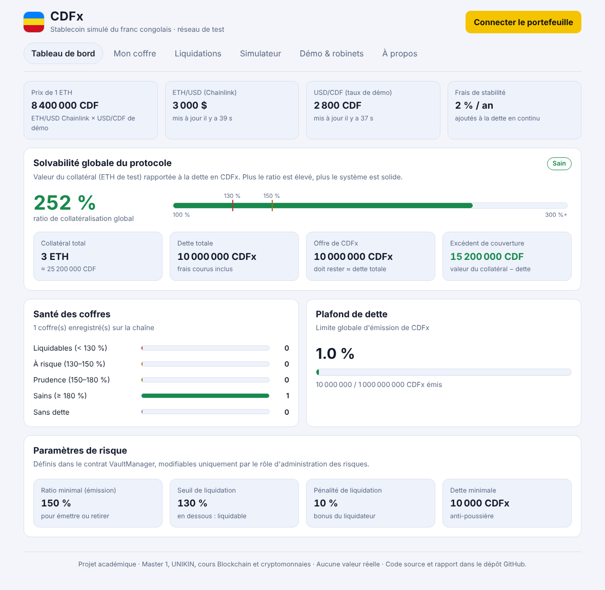
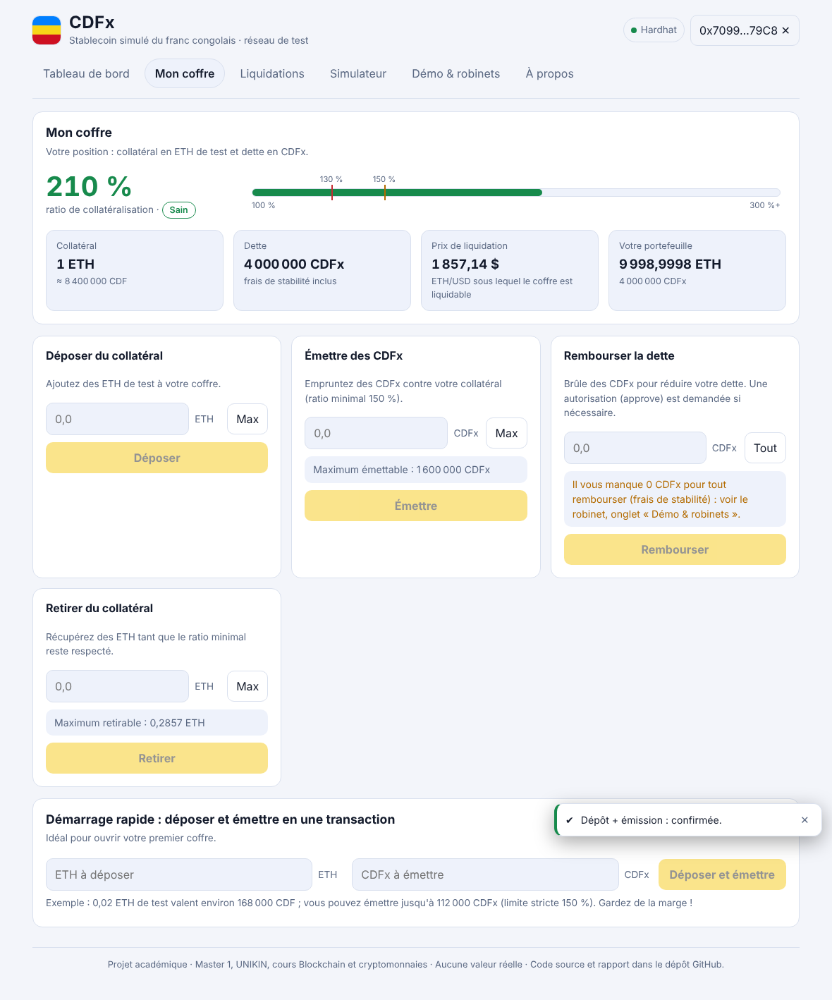

# CDFx — Stablecoin décentralisé indexé sur le franc congolais (version simulée)

Projet du cours **Blockchain et cryptomonnaies** — Master 1, Faculté des Sciences et Technologies, Université de Kinshasa (UNIKIN) — **Groupe 13**.

> ⚠️ Prototype pédagogique, **non audité**, déployé sur le réseau de test **Ethereum Sepolia**. L'ETH et le CDFx utilisés n'ont **aucune valeur réelle**. Aucune vente de jetons, aucune promesse de rendement.

## Membres du groupe

| N° | Nom |
|---|---|
| 1 | MUELA MPIANA POPOL |
| 2 | THEYTHEY KAMBALE KEVIN |
| 3 | TATY MUNSI MANASSE |
| 4 | MBENGA EZIBE ANDERSON |

## Liens (à compléter après le déploiement)

| Élément | Lien |
|---|---|
| DApp (Vercel) | `https://…vercel.app` |
| Dépôt GitHub | `https://github.com/…/cdfx-stablecoin` |
| CDFxToken | `https://sepolia.etherscan.io/address/0x…#code` |
| VaultManager | `https://sepolia.etherscan.io/address/0x…#code` |
| CDFxOracle | `https://sepolia.etherscan.io/address/0x…#code` |
| CDFxFaucet | `https://sepolia.etherscan.io/address/0x…#code` |

Les adresses exactes sont aussi écrites par le script de déploiement dans `deployments/sepolia.json`.

## Objectif

Concevoir un **stablecoin simulé du franc congolais** : 1 CDFx est conçu pour valoir 1 CDF. Le CDFx n'est pas adossé à des francs congolais mais à un **collatéral en ETH de test, surcollatéralisé** (principe des coffres de MakerDAO / Sky) :

1. l'utilisateur dépose de l'ETH dans un **coffre** personnel ;
2. il **émet** des CDFx tant que son collatéral vaut au moins **150 %** de sa dette ;
3. il paie des **frais de stabilité** (2 % / an) ajoutés à sa dette ;
4. si son ratio passe sous **130 %**, n'importe qui peut le **liquider** et reçoit le collatéral avec un bonus de **10 %** ;
5. un **tableau de bord de solvabilité** montre en permanence la santé du système.

## Fonctionnalités

- Coffres surcollatéralisés en ETH de test (dépôt, émission, remboursement, retrait)
- Oracle : **Chainlink ETH/USD** (réel) × **taux USD/CDF de démonstration** (borné, ±10 % par mise à jour)
- Frais de stabilité (indice de dette continu, comme MakerDAO)
- Liquidation partielle ou totale, gestion de la dette irrécouvrable
- Pause d'urgence, rôles d'accès, paramètres de risque bornés
- Tableau de bord de solvabilité, simulateur de stress, liste des coffres liquidables
- Robinet de démonstration de CDFx
- Tests automatisés (unitaires + scénarios aléatoires d'invariants), analyse Slither, rapport de gas

## Architecture

```
  Navigateur (React + wagmi/viem)  ──lecture/écriture──►  MetaMask ──►  Ethereum Sepolia
        │                                                                     │
        │ (Vercel)                                          ┌─────────────────┴───────────────────┐
        ▼                                                   │  VaultManager (coffres, liquidation)│
  Interface :                                               │     │ mint / burnFrom               │
  Tableau de bord · Mon coffre ·                            │     ▼                               │
  Liquidations · Simulateur · Démo                          │  CDFxToken (ERC-20)                 │
                                                            │  CDFxOracle ─► Chainlink ETH/USD    │
                                                            │       └─ taux USD/CDF (démonstration)│
                                                            │  CDFxFaucet (CDFx de démonstration) │
                                                            └─────────────────────────────────────┘
```

**Sur la chaîne** : 4 contrats Solidity 0.8.24. **Hors chaîne** : uniquement la DApp statique (aucun serveur, aucune base de données, aucune donnée personnelle ; seules des adresses de portefeuille et des montants figurent sur la chaîne).

| Contrat | Rôle |
|---|---|
| `CDFxToken` | ERC-20 « CDFx » (OpenZeppelin : ERC20, ERC20Burnable, AccessControl). Seul le `VaultManager` peut créer des CDFx (`MINTER_ROLE`). |
| `VaultManager` | Coffres, émission, remboursement, retrait, liquidation, frais de stabilité (indice de dette), dette irrécouvrable, pause, paramètres de risque. |
| `CDFxOracle` | Prix ETH en CDF = ETH/USD Chainlink × USD/CDF. Rejette prix ≤ 0, round incohérent, donnée plus vieille que 3 h. Taux borné [1 000 ; 10 000] et ±10 % par mise à jour. |
| `CDFxFaucet` | Distribue 1 000 CDFx/jour/adresse (financés par un vrai coffre). |

### Paramètres par défaut

| Paramètre | Valeur | Bornes (contrat) |
|---|---|---|
| Ratio minimal d'émission / retrait | 150 % | liquidation + 5 % ≤ ratio ≤ 300 % |
| Seuil de liquidation | 130 % | ≥ 110 % et ≥ 100 % + pénalité + 5 % |
| Pénalité de liquidation | 10 % | ≤ 20 % |
| Frais de stabilité | 2 % / an | ≤ 20 % / an |
| Dette minimale par coffre | 10 000 CDFx | — |
| Plafond de dette global | 1 milliard de CDFx | — |
| Ancienneté max du prix Chainlink | 3 h | 1 h – 48 h |

## Bonnes pratiques appliquées

| Exigence du sujet | Mise en œuvre |
|---|---|
| Contrôle d'accès | OpenZeppelin `AccessControl` : `MINTER_ROLE`, `RISK_ADMIN_ROLE`, `PAUSER_ROLE`, `RATE_UPDATER_ROLE`, `Ownable` (robinet) |
| Réentrance | `ReentrancyGuard` sur toutes les fonctions qui déplacent des fonds + schéma effets-puis-interactions ; test d'attaque (`ReentrancyAttacker`) |
| Validation des entrées | erreurs personnalisées, montants non nuls, bornes de paramètres, dette minimale, plafond de dette |
| Événements | `CollateralDeposited`, `Minted`, `Repaid`, `Liquidated`, `FeeAccrued`, `VaultUpdated`, `RiskParametersUpdated`… |
| Pas de donnée personnelle | uniquement adresses, montants, événements |
| Résilience oracle | si l'oracle est périmé : émission, retrait avec dette et liquidation sont bloqués ; dépôt et **remboursement restent possibles** |

## Installation et tests

Prérequis : Node.js 22 LTS.

```bash
npm install
npx hardhat test                    # 34 tests
npx hardhat coverage                # couverture
npx hardhat run scripts/gas-report.js
cd frontend && npm install && npm run build
```

Tests (`test/`) :
- `CDFx.test.js` — 31 tests unitaires : jeton, oracle (prix périmé, prix nul, round incohérent, bornes du taux), coffres, frais de stabilité, liquidation totale/partielle, dette irrécouvrable, réentrance, rôles, pause, paramètres, robinet.
- `Invariants.test.js` — 3 campagnes de **750 actions aléatoires au total** (dépôts, émissions, remboursements, retraits, liquidations, chocs de prix, passage du temps) avec vérification, **après chaque action**, de quatre invariants : (I1) l'ETH détenu = collatéral enregistré ; (I2) somme des collatéraux individuels = total ; (I3) offre de CDFx = dette totale (à quelques wei près) ; (I4) cohérence des dettes individuelles. La graine est fixe : les campagnes sont reproductibles.

Couverture mesurée : 98 % des lignes, 96 % des fonctions, 75 % des branches (contrats du protocole).

> Remarque : le sujet cite Foundry pour le fuzzing ; il autorise aussi Hardhat (exigence n° 3). Nous avons choisi **Hardhat** (fonctionne nativement sous Windows). Le fuzzing est réalisé par des campagnes aléatoires reproductibles en JavaScript, pas par le moteur de fuzzing de Foundry.

## Analyse de sécurité

Slither 0.11.6 : **0 résultat de gravité haute**. Les résultats « moyens » et « faibles » sont analysés un par un dans [`docs/SECURITY_ANALYSIS.md`](docs/SECURITY_ANALYSIS.md) (faux positifs justifiés ou choix de conception). Sortie brute : `docs/slither-output.txt`, `docs/slither-report.json`.

Analyse des risques (perte de parité, manipulation d'oracle, liquidation en cascade, gouvernance…) : [`docs/ANALYSE_RISQUES.md`](docs/ANALYSE_RISQUES.md). Coûts en gas : [`docs/GAS_REPORT.md`](docs/GAS_REPORT.md).

## Déploiement

Voir **[GUIDE_DEPLOIEMENT.md](GUIDE_DEPLOIEMENT.md)** (pas à pas, Windows). En résumé :

```bash
cp .env.example .env                 # puis remplir (clé du portefeuille DÉDIÉ, clé Etherscan)
npx hardhat run scripts/deploy.js --network sepolia
npx hardhat run scripts/verify.js --network sepolia
npx hardhat run scripts/seed.js --network sepolia
# DApp : importer le dépôt dans Vercel avec "Root Directory" = frontend
```

Ne **jamais** publier `.env`, une clé privée, une phrase de récupération ou une clé API (`.gitignore` les exclut).

## Captures d'écran

Les captures ci-dessous proviennent d'un réseau local de développement ; remplacez-les par des captures de la DApp déployée sur Sepolia.

| Tableau de bord | Mon coffre |
|---|---|
|  |  |

## Comptes de démonstration

Aucun compte partagé n'est publié. Pour tester : MetaMask sur Sepolia + ETH de test (robinets listés dans l'onglet « Démo & robinets »). Un compte administrateur (déployeur) permet de modifier le taux USD/CDF de démonstration pour provoquer une liquidation.

## Limites et feuille de route vers la production

**Limites actuelles** : prototype non audité ; taux USD/CDF centralisé (démonstration) ; un seul collatéral (ETH) ; liquidation à prix fixe avec bonus (pas d'enchères) ; aucune cotation de marché du CDFx (la parité 1:1 est un objectif de conception) ; administrateur unique.

**Feuille de route** : audit externe et tests de fuzzing/invariants avec Foundry ; flux USD/CDF décentralisé (plusieurs sources, médiane, délai, disjoncteur) ; gouvernance (multisignature + timelock) ; module de stabilité de parité (PSM) ; collatéraux additionnels ; liquidations par enchères ou bots de surveillance ; indexation des événements (The Graph) ; cadre juridique et réglementaire en RDC avant tout usage réel.

## Bibliothèques et références citées

- OpenZeppelin Contracts 5.6.1 (MIT) — ERC20, ERC20Burnable, AccessControl, Ownable, ReentrancyGuard, Pausable, Math, SafeERC20
- Chainlink Contracts 1.5.0 — interface `AggregatorV3Interface`, flux ETH/USD Sepolia `0x694AA1769357215DE4FAC081bf1f309aDC325306`
- Hardhat 2, `@nomicfoundation/hardhat-toolbox`, ethers v6, Chai
- Slither (Trail of Bits) — analyse statique
- React 18, Vite 5, wagmi 2, viem 2, TanStack Query
- Modèle de coffres et d'indice de dette : protocole **MakerDAO (Sky)** — *Dai Stablecoin System* (inspiration conceptuelle ; code entièrement écrit par le groupe)
- Le code des contrats de ce dépôt a été conçu avec l'assistance de Claude (Anthropic).

## Licence

MIT (code du groupe). Voir les licences des dépendances.
