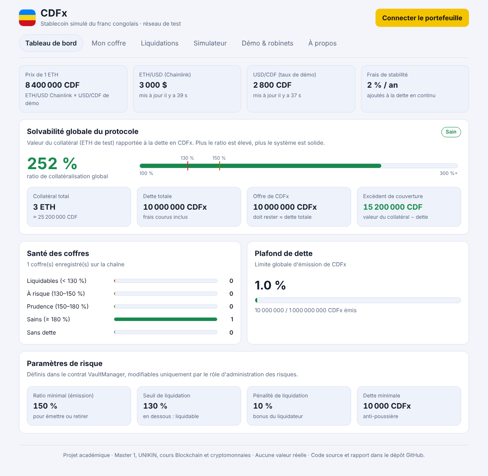
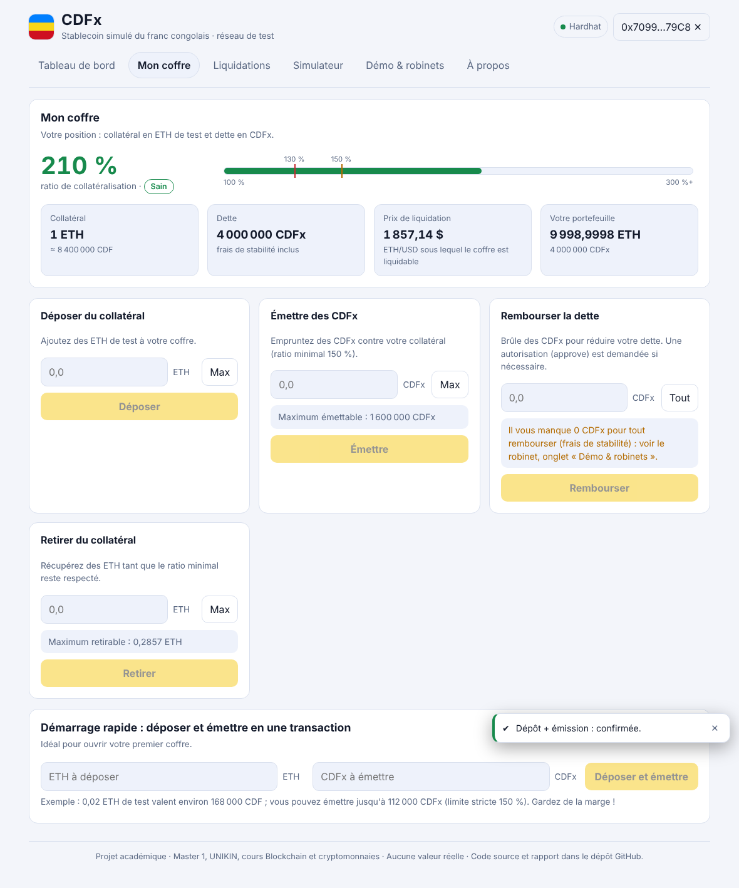

\newpage

# Résumé

Ce rapport présente **CDFx**, un prototype de stablecoin décentralisé dont la valeur est indexée sur le franc congolais (1 CDFx = 1 CDF). Le CDFx n'est pas adossé à des francs congolais détenus en réserve ; il est **créé contre un collatéral en ETH de test, surcollatéralisé**, selon le principe des coffres (*vaults*) du protocole MakerDAO (Sky). Le système comprend quatre contrats intelligents Solidity (jeton, gestionnaire de coffres, oracle de prix, robinet de démonstration), une application web (DApp) React connectée à MetaMask, une batterie de 34 tests automatisés, une analyse statique avec Slither et une analyse des risques.

Le prix de l'ETH en francs congolais est obtenu en multipliant le flux **Chainlink ETH/USD** par un **taux USD/CDF de démonstration** (il n'existe pas de flux Chainlink USD/CDF). Les utilisateurs déposent de l'ETH, émettent des CDFx dans la limite de 150 % de collatéralisation, paient des frais de stabilité de 2 % par an, et peuvent être liquidés sous 130 %. Un tableau de bord de solvabilité, un simulateur de stress et une page de liquidations rendent l'état du système lisible en temps réel.

Le prototype est déployé sur le réseau de test **Ethereum Sepolia** et la DApp est hébergée sur **Vercel**. Tous les jetons utilisés sont sans valeur réelle.

**Mots-clés** : stablecoin, franc congolais, coffre surcollatéralisé, oracle Chainlink, liquidation, Solidity, Sepolia.

\newpage

# Sommaire

1. Introduction · 2. État de l'art et références · 3. Conception du système · 4. Tokenomics · 5. Implémentation · 6. Application décentralisée (DApp) · 7. Tests · 8. Analyse de sécurité (Slither) · 9. Analyse des risques · 10. Coûts en gas · 11. Déploiement · 12. Limites et feuille de route · 13. Conclusion · Références · Annexe A

\newpage

# 1. Introduction

## 1.1 Contexte

Les stablecoins sont des cryptomonnaies conçues pour conserver une valeur stable par rapport à une monnaie de référence. Ils servent de monnaie de paiement et de compte dans la finance décentralisée (DeFi). Trois grandes familles existent : les stablecoins **adossés à des réserves** (USDC, USDT), les stablecoins **surcollatéralisés par des cryptoactifs** (DAI de MakerDAO) et les stablecoins **algorithmiques** (dont plusieurs ont échoué, comme TerraUSD en 2022).

En République démocratique du Congo, l'économie est fortement dollarisée et le franc congolais (CDF) est soumis à des variations de change. Un jeton indexé sur le CDF, transparent et vérifiable sur une blockchain publique, pourrait faciliter des paiements et des contrats libellés en monnaie locale. Ce projet en explore **la faisabilité technique**, sur un réseau de test, sans valeur réelle.

## 1.2 Problématique

*Comment concevoir, avec des contrats intelligents, un jeton dont la valeur reste proche de 1 franc congolais, sans réserve de francs congolais, en garantissant la solvabilité du système et en limitant les risques d'oracle ?*

## 1.3 Objectifs

1. Concevoir des **coffres surcollatéralisés** en ETH de test avec émission et remboursement de CDFx.
2. Construire un **oracle** combinant Chainlink ETH/USD et un taux USD/CDF de démonstration.
3. Mettre en place les **frais de stabilité** et la **liquidation** sous un seuil de collatéralisation.
4. Fournir un **tableau de bord de solvabilité** et une DApp utilisable avec MetaMask.
5. Tester (unitaires et invariants), analyser la sécurité (Slither) et analyser les risques.
6. Déployer sur **Ethereum Sepolia** (code vérifié sur Etherscan) et publier la DApp sur **Vercel**.

## 1.4 Périmètre et contraintes éthiques

Le projet n'utilise que des réseaux de test et des jetons sans valeur. Il n'y a ni levée de fonds, ni vente de jetons, ni promesse de rendement. Aucune donnée personnelle n'est écrite sur la chaîne (uniquement des adresses de portefeuille, des montants et des événements). Les clés privées et clés d'API sont exclues du dépôt GitHub.

# 2. État de l'art et références

**MakerDAO / Sky (DAI).** Le DAI est émis lorsque des utilisateurs verrouillent des cryptoactifs dans des coffres. La dette est suivie par un indice qui croît avec les frais de stabilité (*rate accumulator*), et les coffres sous le seuil sont liquidés. Notre `VaultManager` reprend ce **modèle conceptuel** (dette normalisée × indice de dette, seuils, pénalité) avec un code entièrement original et simplifié : un seul collatéral, liquidation à prix fixe avec bonus et non par enchères.

**Chainlink Data Feeds.** Réseau décentralisé d'oracles qui publie des prix agrégés sur la chaîne via l'interface `AggregatorV3Interface`. Nous utilisons le flux ETH/USD de Sepolia (adresse `0x694AA1769357215DE4FAC081bf1f309aDC325306`, 8 décimales). Il n'existe pas de flux USD/CDF : un taux de démonstration est donc ajouté, ce qui constitue la **principale limite** du prototype (section 9).

**OpenZeppelin Contracts 5.6.1.** Bibliothèque auditée et largement utilisée : `ERC20`, `ERC20Burnable`, `AccessControl`, `Ownable`, `ReentrancyGuard`, `Pausable`, `Math`, `SafeERC20`.

| Famille | Exemple | Mécanisme de stabilité | Risque principal |
|---|---|---|---|
| Adossé à des réserves | USDC | réserves en monnaie fiduciaire | confiance dans l'émetteur, centralisation |
| Surcollatéralisé (crypto) | DAI, **CDFx** | collatéral > dette, liquidations | chute rapide du collatéral, oracle |
| Algorithmique | TerraUSD | incitations d'arbitrage sans collatéral | spirale de perte de parité |

# 3. Conception du système

## 3.1 Vue d'ensemble

```
 Utilisateur ── MetaMask ── DApp React (Vercel) ── RPC ── Ethereum Sepolia
                                                          │
          ┌───────────────────────────────────────────────┤
          │  VaultManager ──mint/burnFrom──► CDFxToken    │
          │       │                                        │
          │       └──────── lit le prix ────► CDFxOracle ──► Chainlink ETH/USD
          │                                      └─ taux USD/CDF (démonstration)
          │  CDFxFaucet (distribue des CDFx de démonstration)
          └────────────────────────────────────────────────┘
```

**Sur la chaîne** : quatre contrats. **Hors chaîne** : uniquement l'application web statique, sans serveur ni base de données.

## 3.2 Les contrats

| Contrat | Rôle | Éléments clés |
|---|---|---|
| `CDFxToken` | Jeton ERC-20 « CDFx », 18 décimales | seul le rôle `MINTER_ROLE` (le `VaultManager`) peut créer des CDFx ; tout détenteur peut en brûler |
| `VaultManager` | Cœur du protocole | coffres, émission, remboursement, retrait, liquidation, frais de stabilité, dette irrécouvrable, pause |
| `CDFxOracle` | Prix ETH en CDF | Chainlink ETH/USD × taux USD/CDF ; validations d'intégrité et de fraîcheur |
| `CDFxFaucet` | Robinet | 1 000 CDFx par adresse et par jour, financé par un vrai coffre |

## 3.3 Formules

Notations : **C** = collatéral du coffre (en ETH) ; **P** = prix de 1 ETH en CDF ; **D** = dette en CDFx.

- Prix de l'ETH en CDF : **P = (prix ETH/USD) × (taux USD/CDF de démonstration)**.
- Ratio de collatéralisation : **R = (C × P) / D**.
- Émission autorisée si **R ≥ 150 %** (ratio minimal) ; liquidation possible si **R < 130 %** (seuil de liquidation).
- Prix de liquidation (en CDF par ETH) : **P_liq = (D × 130 %) / C**.
- Liquidation : le liquidateur rembourse **x** CDFx et reçoit un collatéral valant **x × (1 + 10 %)**, plafonné au collatéral du coffre.
- Dette avec frais : on stocke une dette normalisée **dn** ; la dette réelle est **D = dn × I**, où **I** est l'indice de dette. L'indice croît avec le temps selon le taux par seconde équivalent à 2 % par an : **I(t + Δt) = I(t) × (1 + r × Δt)**.

Exemple chiffré : 1 ETH = 3 000 USD × 2 800 CDF/USD = 8 400 000 CDF. Avec 1 ETH de collatéral, on peut émettre au plus 8 400 000 / 1,5 = 5 600 000 CDFx. À 5 000 000 CDFx de dette, le ratio est de 168 % et le coffre devient liquidable lorsque 1 ETH vaut moins de 5 000 000 × 1,3 = 6 500 000 CDF, soit environ 2 321 USD par ETH à taux inchangé.

## 3.4 Cycle de vie d'un coffre

1. **Dépôt** : `depositCollateral()` ou `depositAndMint()` (ETH envoyé avec l'appel).
2. **Émission** : `mint(montant)` ; le contrat applique les frais courus, vérifie la dette minimale (10 000 CDFx), le plafond global, puis le ratio ≥ 150 % avant de créer les CDFx.
3. **Remboursement** : `repay(montant)` après un `approve` du CDFx ; la dette diminue, les CDFx sont brûlés. Aucun oracle n'est requis : l'utilisateur peut toujours sortir.
4. **Retrait** : `withdrawCollateral(montant)` tant que le ratio reste ≥ 150 % (libre sans dette).
5. **Liquidation** : `liquidate(propriétaire, montant)` si le ratio R est inférieur à 130 %.
6. **Dette irrécouvrable** : si le collatéral est épuisé avant la fin du remboursement, le reste est enregistré comme dette irrécouvrable (`badDebt`) et peut être effacé par n'importe quel détenteur de CDFx via `settleBadDebt`.

## 3.5 Frais de stabilité et offre de CDFx

À chaque interaction, `drip()` met à jour l'indice de dette. Les frais accumulés sont **créés en CDFx pour la trésorerie** : l'offre totale de CDFx reste ainsi égale à la dette totale (invariant testé). Les CDFx de la trésorerie permettent de financer le remboursement des frais par les emprunteurs (la dette dépasse toujours un peu les CDFx émis). Dans la démonstration, le robinet joue ce rôle.

## 3.6 Paramètres de risque

| Paramètre | Valeur par défaut | Bornes imposées par le contrat |
|---|---|---|
| Ratio minimal (émission, retrait) | 150 % | ≥ seuil de liquidation + 5 % ; ≤ 300 % |
| Seuil de liquidation | 130 % | ≥ 110 % et ≥ 100 % + pénalité + 5 % |
| Pénalité de liquidation | 10 % | ≤ 20 % |
| Frais de stabilité | 2 % / an | ≤ 20 % / an |
| Dette minimale par coffre | 10 000 CDFx | — |
| Plafond de dette global | 1 milliard de CDFx | — |
| Ancienneté maximale du prix Chainlink | 3 h | de 1 h à 48 h |
| Taux USD/CDF (démonstration) | 2 800 | de 1 000 à 10 000 ; ±10 % par mise à jour |

# 4. Tokenomics

- **Nom et symbole** : Congolese Franc Stablecoin (simulated), CDFx ; 18 décimales.
- **Offre** : variable, égale à la dette totale du système. Il n'existe **aucune pré-création, aucune allocation à l'équipe, aucune vente, aucun plafond d'offre fixe** (hors plafond de dette de 1 milliard de CDFx).
- **Création** : uniquement par le `VaultManager` contre du collatéral ; **destruction** : remboursement, liquidation, effacement de dette irrécouvrable.
- **Valeur** : conçue pour 1 CDF ; maintenue par la surcollatéralisation et les incitations d'arbitrage (section 9).
- **Revenus du protocole** : frais de stabilité (2 %/an) versés à la trésorerie en CDFx. Dans la version de démonstration, la trésorerie est le compte du déployeur ; en production, elle serait contrôlée par une gouvernance.
- **Pas de rendement promis** : le CDFx ne verse aucun intérêt à ses détenteurs.

# 5. Implémentation

## 5.1 Technologies

| Couche | Outils |
|---|---|
| Contrats | Solidity 0.8.24, OpenZeppelin 5.6.1, Chainlink Contracts 1.5.0 |
| Développement et tests | Hardhat 2, ethers v6, Chai, hardhat-network-helpers, solidity-coverage |
| Analyse de sécurité | Slither 0.11.6 |
| DApp | React 18, Vite 5, wagmi 2, viem 2, TanStack Query |
| Déploiement | Ethereum Sepolia, Etherscan (vérification), GitHub, Vercel |

## 5.2 Structure du dépôt

```
contracts/    CDFxToken.sol  CDFxOracle.sol  VaultManager.sol  CDFxFaucet.sol
contracts/test/   MockV3Aggregator.sol  ReentrancyAttacker.sol   (tests uniquement)
test/         CDFx.test.js (31 tests)   Invariants.test.js (3 campagnes)
scripts/      deploy.js  verify.js  seed.js  set-rate.js  gas-report.js
frontend/     DApp React (Vite)
docs/         SECURITY_ANALYSIS.md  ANALYSE_RISQUES.md  GAS_REPORT.md  rapport Slither
```

## 5.3 Bonnes pratiques appliquées

- **Contrôle d'accès** : rôles OpenZeppelin (`MINTER_ROLE`, `RISK_ADMIN_ROLE`, `PAUSER_ROLE`, `RATE_UPDATER_ROLE`).
- **Protection contre la réentrance** : `nonReentrant` et effets avant interactions ; un contrat attaquant de test échoue à retirer deux fois.
- **Validation des entrées** : erreurs personnalisées (`ZeroAmount`, `Undercollateralized`, `BelowMinDebt`, `DebtCeilingExceeded`…).
- **Événements** pour la traçabilité : `Minted`, `Repaid`, `Liquidated`, `FeeAccrued`, `VaultUpdated`, `RiskParametersUpdated`.
- **Arrondis prudents** : dette arrondie vers le haut, de sorte que l'offre de CDFx ne soit jamais inférieure à la dette.
- **Pause d'urgence** qui laisse toujours possibles le remboursement et le retrait.
- **Aucune donnée personnelle** sur la chaîne.

## 5.4 L'oracle

`CDFxOracle.ethPriceCdf()` lit `latestRoundData()` du flux Chainlink et rejette : un prix nul ou négatif, un round incohérent (`answeredInRound < roundId`), une date dans le futur, ou une donnée plus ancienne que 3 heures. Le prix est converti à 18 décimales à partir des décimales du flux. Le taux USD/CDF est modifiable par le seul rôle `RATE_UPDATER_ROLE`, avec des bornes absolues et une variation maximale de 10 % par appel, ce qui limite l'effet d'une clé compromise.

# 6. Application décentralisée (DApp)

La DApp est une application React statique qui lit directement les contrats via wagmi/viem et envoie les transactions par MetaMask. Avant chaque transaction, elle **simule** l'appel pour afficher un message d'erreur clair (par exemple « ratio de collatéralisation insuffisant ») au lieu d'un échec brut.

| Onglet | Fonction |
|---|---|
| Tableau de bord | prix ETH/CDF, ETH/USD Chainlink, taux de démonstration, **ratio de solvabilité global**, excédent ou déficit de couverture, santé des coffres, plafond de dette, paramètres de risque |
| Mon coffre | dépôt, émission, remboursement, retrait avec **aperçu du ratio avant signature**, prix de liquidation |
| Liquidations | liste des coffres triés par risque, liquidation en un clic, effacement de la dette irrécouvrable |
| Simulateur | scénarios de stress (ETH −20 %, −40 %, −60 %, taux USD/CDF −10 %) et courbe ratio / prix |
| Démo & robinets | liens vers les robinets d'ETH Sepolia, robinet de CDFx, panneau administrateur (taux, pause) |
| À propos | adresses des contrats, fonctionnement, limites |

{width=95%}

{width=95%}

La DApp a été testée dans un navigateur automatisé avec un portefeuille simulé : connexion, dépôt + émission en une transaction, réclamation au robinet, approbation + remboursement total, et affichage sur mobile (390 px) sans défilement horizontal.

# 7. Tests

## 7.1 Tests unitaires (31)

| Domaine | Vérifications principales |
|---|---|
| Jeton | seul le `VaultManager` peut créer des CDFx |
| Oracle | prix correct (8 400 000 CDF pour 1 ETH) ; rejet d'un prix périmé, nul, négatif ou d'un round incohérent ; bornes et variation du taux ; validation du constructeur |
| Coffres | dépôt, émission jusqu'à exactement 150 %, dette minimale, plafond, `depositAndMint`, retrait, remboursement partiel/total, oracle périmé |
| Frais | ≈ 2 % par an ; offre = dette ; remboursement complet avec les frais |
| Liquidation | coffre sain refusé ; totale (gain du liquidateur ≈ 0,8929 ETH, reste rendu au propriétaire) ; partielle ; **dette irrécouvrable** ; liquidation provoquée par le taux USD/CDF |
| Sécurité | **réentrance bloquée** ; contrôle d'accès ; paramètres invalides ; pause ; changement de taux de frais et de trésorerie |
| Robinet | une réclamation par période ; épuisement ; droits du propriétaire |

## 7.2 Campagnes aléatoires d'invariants (3 × 250 actions)

Trois graines fixes (1, 7, 42) génèrent chacune 250 actions pseudo-aléatoires : dépôts, émissions, remboursements, retraits, liquidations, variations du prix ETH entre 1 100 et 4 700 USD, et passage du temps jusqu'à 20 jours. Après **chaque** action, quatre invariants sont vérifiés :

- **I1** : l'ETH détenu par le contrat est égal au collatéral enregistré ;
- **I2** : la somme des collatéraux individuels est égale au collatéral total ;
- **I3** : l'offre de CDFx est égale à la dette totale, à quelques wei d'arrondi près ;
- **I4** : la somme des dettes individuelles est cohérente avec la dette totale moins la dette irrécouvrable.

En outre, tout coffre qui vient d'émettre ou de retirer doit avoir un ratio ≥ 150 %. Les trois campagnes passent (environ 200 actions effectivement exécutées par campagne ; le reste est sans objet ou refusé par les règles du contrat).

> **Remarque méthodologique.** Le sujet cite Foundry pour le fuzzing. Nous avons choisi Hardhat, accepté par le sujet, pour sa compatibilité native avec Windows. Les campagnes ci-dessus sont des tests aléatoires reproductibles écrits en JavaScript ; ils ne remplacent pas le moteur de fuzzing de Foundry, prévu dans la feuille de route.

## 7.3 Résultats

| Mesure | Résultat |
|---|---|
| Tests exécutés | **34 réussis, 0 échec** |
| Couverture des lignes | 98 % (contrats du protocole : 99 % pour `VaultManager`, 100 % pour l'oracle et le jeton) |
| Couverture des fonctions | 96 % |
| Couverture des branches | 75 % |

# 8. Analyse de sécurité (Slither)

Slither 0.11.6 a analysé les quatre contrats (102 détecteurs). **Aucun résultat de gravité haute.** Les résultats moyens (33) et faibles (29) sont détaillés dans `docs/SECURITY_ANALYSIS.md` ; ce sont des faux positifs ou des choix de conception justifiés (comparaisons à zéro, valeurs de retour volontairement ignorées, appel à notre propre jeton de confiance, usage nécessaire de `block.timestamp`).

| Détecteur | Nombre | Décision |
|---|---:|---|
| `incorrect-equality` (moyenne) | 16 | faux positif : comparaisons exactes sur des valeurs internes |
| `reentrancy-no-eth` (moyenne) | 7 | appel à notre ERC-20 sans hook, fonctions `nonReentrant` |
| `unused-return` (moyenne) | 9 | seul le prix est utile ; la fraîcheur est validée dans l'oracle |
| `divide-before-multiply` (moyenne) | 1 | précision RAY (10^27), perte négligeable |
| `timestamp`, `reentrancy-benign`, `reentrancy-events`, `missing-zero-check` (faibles) | 29 | nécessaires ou voulus |

**Correction réalisée grâce à l'analyse** : dans `drip()`, l'indice de dette est désormais mis à jour **avant** l'appel externe de création des frais (schéma effets-puis-interactions).

Cette analyse statique et ces tests **ne constituent pas un audit** : un audit indépendant serait nécessaire avant tout usage réel.

# 9. Analyse des risques

## 9.1 Perte de parité

La parité repose sur quatre mécanismes : (1) la **surcollatéralisation** (150 %) ; (2) l'**arbitrage vers le bas** (sous 1 CDF, racheter des CDFx pour solder une dette est avantageux, donc la demande remonte le prix) ; (3) l'**arbitrage vers le haut** (au-dessus de 1 CDF, émettre est rentable, donc l'offre augmente) ; (4) les **liquidations**, qui retirent les dettes risquées. Un coffre à 150 % devient liquidable après une baisse d'environ 13 % de l'ETH et ne devient insolvable qu'après environ 33 %.

| Scénario | Effet | Mesures actuelles | En production |
|---|---|---|---|
| Chute brutale de l'ETH | liquidations massives, dette irrécouvrable | pénalité 10 %, `settleBadDebt`, simulateur | module de stabilité, fonds de réserve, enchères, plusieurs collatéraux |
| Peu de liquidateurs | coffres insolvables non liquidés | bonus 10 %, liquidation ouverte | robots de surveillance |
| Ruée / perte de confiance | CDFx < 1 CDF | remboursement toujours possible | pool de liquidité, PSM |
| Taux USD/CDF erroné | collatéral mal valorisé | bornes, ±10 % par mise à jour | flux décentralisé |

**Limite essentielle** : aucun marché n'échange le CDFx dans ce prototype. La parité est un objectif de conception démontré par les mécanismes et le simulateur, pas un prix de marché observé.

## 9.2 Manipulation et défaillance de l'oracle

| Menace | Protection actuelle | Amélioration en production |
|---|---|---|
| Donnée périmée | rejet au-delà de 3 h ; émission, retrait avec dette et liquidation bloqués ; dépôt et remboursement permis | disjoncteur, valeur de repli |
| Prix invalide (≤ 0, round incohérent) | `InvalidPrice` | bornes de variation entre deux lectures |
| Manipulation du taux USD/CDF | bornes absolues, ±10 % par mise à jour, événement émis | multisignature, timelock, flux décentralisé |
| Manipulation du prix ETH | prix agrégé par un réseau de nœuds Chainlink (pas un prix spot d'une seule bourse) | second flux de contrôle, seuil de déviation |
| Décimales du flux | normalisation à 18 décimales, test avec 8 décimales | — |

## 9.3 Autres menaces

Réentrance (traitée), débordements (Solidity 0.8 et `Math.mulDiv`), poussière de dette (dette minimale), clé d'administrateur compromise (paramètres bornés, rôles séparés, pause ; multisignature en production), erreurs utilisateur (simulation avant envoi, aperçu du ratio), confidentialité (aucune donnée personnelle), conformité (cadre légal congolais à étudier avant tout usage réel).

# 10. Coûts en gas

Mesurés avec l'optimiseur activé (200 runs). Le coût en ETH est indicatif (gas × prix du gas) ; sur Sepolia, l'ETH n'a aucune valeur.

| Opération | Gas | Coût à 1 gwei (ETH) | Coût à 20 gwei (ETH) |
|---|---:|---:|---:|
| Déploiement `CDFxToken` | 826 861 | 0,000827 | 0,016537 |
| Déploiement `CDFxOracle` | 788 132 | 0,000788 | 0,015763 |
| Déploiement `VaultManager` | 2 736 904 | 0,002737 | 0,054738 |
| Déploiement `CDFxFaucet` | 493 868 | 0,000494 | 0,009877 |
| `depositCollateral` (1er dépôt) | 95 541 | 0,000096 | 0,001911 |
| `mint` (1re émission) | 172 316 | 0,000172 | 0,003446 |
| `depositAndMint` | 177 538 | 0,000178 | 0,003551 |
| `approve` (CDFx) | 26 809 | 0,000027 | 0,000536 |
| `repay` (partiel) | 90 237 | 0,000090 | 0,001805 |
| `withdrawCollateral` | 106 384 | 0,000106 | 0,002128 |
| `liquidate` (totale) | 121 537 | 0,000122 | 0,002431 |
| `faucet.claim` | 63 938 | 0,000064 | 0,001279 |

Le déploiement complet représente environ 4,85 millions de gas. Le regroupement `depositAndMint` économise une transaction par rapport à deux appels séparés.

# 11. Déploiement

| Élément | Valeur |
|---|---|
| Réseau | Ethereum Sepolia (chaîne 11155111) |
| `CDFxToken` | **[À COMPLÉTER : adresse et lien Etherscan]** |
| `CDFxOracle` | **[À COMPLÉTER]** |
| `VaultManager` | **[À COMPLÉTER]** |
| `CDFxFaucet` | **[À COMPLÉTER]** |
| Flux Chainlink ETH/USD | `0x694AA1769357215DE4FAC081bf1f309aDC325306` |
| DApp (Vercel) | **[À COMPLÉTER : URL]** |
| Dépôt GitHub | **[À COMPLÉTER : URL]** |

La procédure complète (installation, clés, déploiement, vérification Etherscan, GitHub, Vercel) est décrite dans `GUIDE_DEPLOIEMENT.md`. Le portefeuille de déploiement est un compte MetaMask dédié ne contenant que des ETH de test ; aucune clé n'est publiée.

**[À COMPLÉTER : insérer ici 3 captures de la DApp sur Sepolia et 1 capture d'Etherscan montrant « Contract Source Code Verified ».]**

# 12. Limites et feuille de route

## 12.1 Limites

- Prototype **non audité**, sur réseau de test, sans valeur réelle.
- Taux USD/CDF **centralisé** (donnée de démonstration contrôlée par un administrateur).
- Un seul collatéral (ETH) ; liquidation à prix fixe avec bonus, sans enchères.
- **Aucun marché** pour le CDFx : parité non mesurée sur un marché.
- Administrateur unique dans la version de démonstration.
- Fuzzing par tests aléatoires en JavaScript, pas par Foundry.

## 12.2 Feuille de route vers la production

1. **Sécurité** : fuzzing et tests d'invariants avec Foundry/Echidna, audit externe, programme de bug bounty.
2. **Oracle** : flux USD/CDF décentralisé (plusieurs sources, médiane, délai, disjoncteur).
3. **Gouvernance** : multisignature + timelock, paramètres de risque votés.
4. **Stabilité** : module de stabilité de parité (PSM), fonds de réserve, enchères de liquidation, collatéraux additionnels.
5. **Écosystème** : pool de liquidité, indexation des événements (The Graph), surveillance et alertes.
6. **Cadre légal** : analyse réglementaire en RDC et conformité LCB-FT avant tout usage réel.

# 13. Conclusion

Le projet démontre qu'un stablecoin indexé sur une monnaie locale peut être conçu avec des contrats simples et vérifiables : coffres surcollatéralisés, oracle à double source, frais de stabilité, liquidation ouverte et tableau de bord de solvabilité. Les tests (34 réussis, quatre invariants vérifiés sur 750 actions aléatoires) et l'analyse Slither (aucun résultat de gravité haute) donnent une confiance raisonnable dans la logique, sans remplacer un audit. La principale difficulté, commune à tous les stablecoins locaux, reste **l'oracle de change** : sa décentralisation est la priorité avant toute évolution vers la production.

# Références

1. MakerDAO. *The Maker Protocol: MakerDAO's Multi-Collateral Dai (MCD) System* (documentation, 2020) et documentation Sky.
2. Chainlink. *Data Feeds — Price Feeds (Ethereum Sepolia)*. docs.chain.link.
3. OpenZeppelin. *OpenZeppelin Contracts 5.x*. docs.openzeppelin.com/contracts.
4. Ethereum Foundation. *ERC-20 Token Standard (EIP-20)*. eips.ethereum.org/EIPS/eip-20.
5. Trail of Bits. *Slither, the Solidity source analyzer*. github.com/crytic/slither.
6. Nomic Foundation. *Hardhat documentation*. hardhat.org.
7. wagmi et viem. *Documentation*. wagmi.sh, viem.sh.
8. Le code a été conçu avec l'assistance de Claude (Anthropic), outil d'IA générative.

# Annexe A — Scénario de démonstration

1. Obtenir des ETH Sepolia et connecter MetaMask.
2. *Mon coffre* : déposer 0,02 ETH et émettre des CDFx ; observer l'aperçu du ratio.
3. *Simulateur* : tester ETH −40 % et taux USD/CDF −10 %.
4. *Démo & robinets* (administrateur) : baisser le taux USD/CDF de 10 % deux fois.
5. *Liquidations* : depuis un second compte, liquider le coffre devenu sous 130 % et constater la pénalité de 10 %.
6. Etherscan : consulter les événements `Minted` et `Liquidated`.
